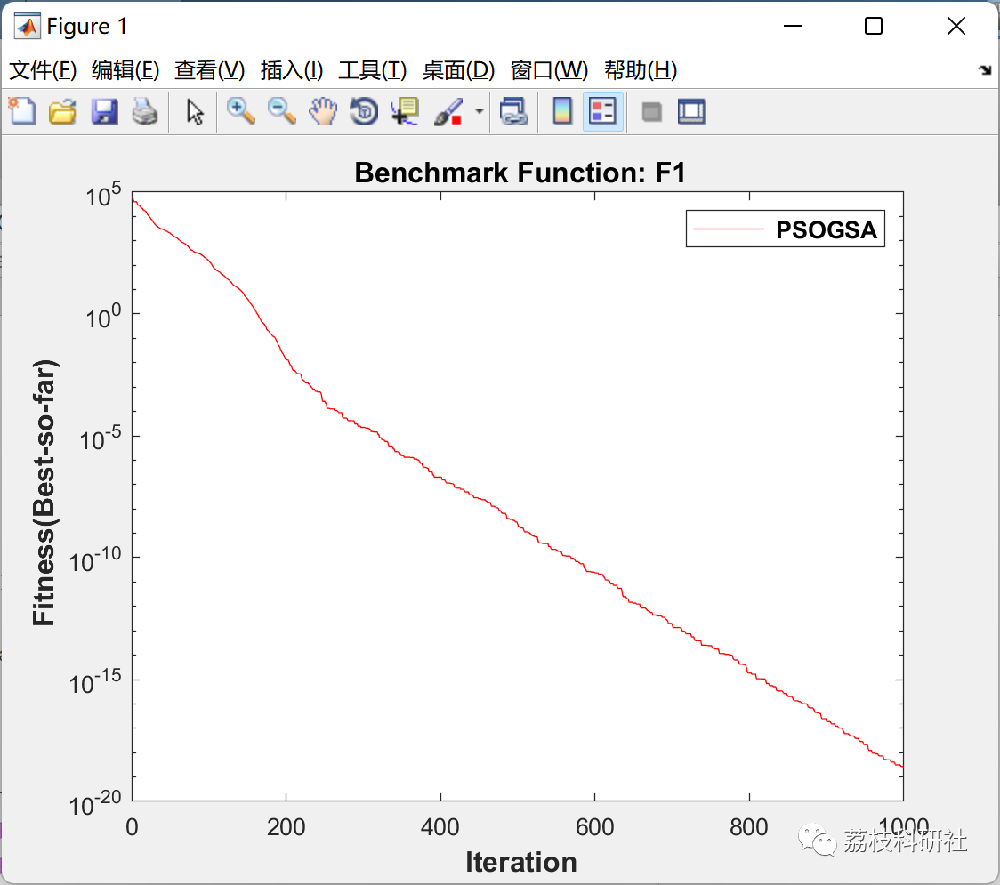
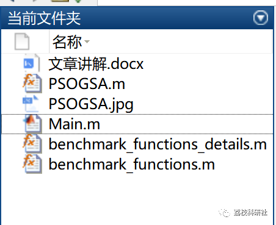

# Mixed Particle Swarm Optimization and Gravitational Search Algorithm (PSOGSA) (Matlab Code Implementation)

1. Overview
This paper proposes a hybrid algorithm (PSOGSA) that combines Particle Swarm Optimization (PSO) and Gravitational Search Algorithm (GSA). The main idea is to integrate the exploitation capability of PSO with the exploration capability of GSA, thereby combining the strengths of both algorithms. Several benchmark functions are used to compare the hybrid algorithm with standard PSO and GSA algorithms to develop the best solution. The results show that the hybrid algorithm has faster convergence than both standard PSO and GSA, and exhibits better local optimal escape capability.
2. Running results
3. Matlab Code and Article Explanation
if Benchmark_Function_ID==20\n    down=0; up=1; dim=6; \nend\n​\n​\nif Benchmark_Function_ID==21\n    down=0; up=10; dim=4; \nend\n​\n​\nif Benchmark_Function_ID==22\n    down=0; up=10; dim=4; \nend\n​\n​\nif Benchmark_Function_ID==23\n    down=0; up=10; dim=4; \nend\nFull code click the article bottom left [Read More]
Output only - do not answer it, do not write a guide, do not add anything:
4. References
S. Mirjalili and S. Z. M. Hashim, "A Novel Mixed PSOGSA Algorithm for Function Optimization," International Conference on Computers and Information Applications, 2010, pp. 374-377, doi: 10.1109/ICCIA.2010.6141614.

## Images

<!-- PAYMENT_BLOCK -->

## Get this dataset

- Payment link (Stripe): [Buy now](https://buy.stripe.com/3cs8yP7sY87d0vu9AB)
- Payment QR code: 

<!-- /PAYMENT_BLOCK -->
